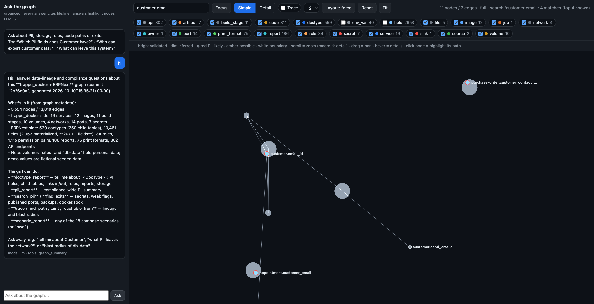

# Lineage — frappe_docker + ERPNext, with a chat agent over the graph

One evidence-backed artifact + a chat agent + six focused views:

- **One graph** — `data/graph.json` (5,554 nodes, 13,819 edges) merging the
  **deployment layer** (frappe_docker: services, volumes, ports, secrets,
  backups) with the **data layer** (ERPNext v16.50.0: 529 DocTypes, 2,953
  materialized fields, 811 controllers that read/write them, 802 API
  endpoints, roles, reports, print formats, the email sink).
- **Every node and edge carries evidence** (`file:line` + snippet verified
  against the real source), a confidence tier (`validated | parsed |
  inferred`), a sensitivity flag and scenario tags. Secrets are masked,
  never stored. `lineage audit` re-checks all ~20k evidence entries
  line-by-line against the cloned repos.
- **A grounded chat agent** — WebGL graph + chat sidebar. Answers come from a
  real LLM tool-calling loop (tested with **OpenCode Go**, any
  OpenAI-compatible endpoint works) or a deterministic router when no key is
  configured. Answers cite `file:line`, highlight their nodes in the graph
  (click any node to highlight its path), and the search box is fuzzy + live.



**Live static demo (GitHub Pages):** <https://aditi21372.github.io/erpnext-lineage/>
— the interactive graph and the six views run fully client-side.
**Note: the LLM chat cannot run on this static URL** (it needs the tool-loop
server + your API key) — start it locally with one Docker command, see
[For reviewers](#for-reviewers--3-steps).

## For reviewers — 3 steps

```bash
# 1. build & start (first run clones the two pinned repos and builds the graph)
docker compose up --build        # watch progress: docker compose logs -f lineage
# 2. open the chat + graph
open http://localhost:8765           # (views: http://localhost:8765/views/)
```

```bash
# 3. (optional but recommended) enable LLM answers:
cp .env.example .env
#    fill OPENAI_BASE_URL / OPENAI_API_KEY / OPENAI_MODEL   (see "LLM setup")
docker compose up -d             # recreates with the new env — data is kept
```

First boot takes ~2–4 minutes (git clone of the two upstream repos). After
that, restarts are instant — sources, graph, demo data and views live in
named volumes. The chat header shows **`LLM: on/off`** so you always know
which mode you are talking to.

## How it works

```
frontend                     backend (one Python package: src/lineage/)
────────                     ─────────────────────────────────────────────
viewer.py  ── renders ──►    build.py ── orchestrates ──► docker_parser.py (frappe_docker)
 Sigma.js WebGL               frappe_parser.py (erpnext) ──► data/graph.json
 + Graphology                 (every node/edge: evidence file:line, confidence,
 + d3-force layout            sensitivity, boundary, scenarios)
 + chat sidebar   ◄── HTTP ── chat.py  GET /  /views/  /vendor/  /api/meta
 fuzzy search                 POST /api/ask ──► agent.py (grounded tool loop)
 click = highlight path                          └─► tools.py (13 read-only tools)
```

**Backend**

| module | role |
|---|---|
| `docker_parser.py` / `frappe_parser.py` | repo adapters → nodes/edges with evidence (compose/Dockerfile/bake; DocType JSON/Link/fetch_from/roles/reports + regex flow scan) |
| `build.py` | merges both layers, tags scenarios, writes `data/graph.json` (deterministic, ~5 s) |
| `tools.py` | 13 read-only graph tools (table below) — plain data, evidence-backed |
| `agent.py` | grounded LLM tool loop (OpenAI-compatible) + deterministic keyword router fallback; multi-turn history |
| `chat.py` | zero-dependency HTTP server: `/api/ask` (POST), `/api/meta`, `/vendor/*`, `/views/*` |
| `audit.py` | adversarial pass: schema, unique ids, every evidence entry vs the real repos, leak scan |
| `views.py` / `render.py` / `dummy.py` | six focused HTML views / Mermaid+DOT export / fictional demo data |

**Frontend** — `viewer.py` generates one self-contained page (also used, sliced,
by `views.py`): **Sigma.js WebGL** renders 5.5k nodes at ~120 fps with a
one-shot `d3-force` layout (no live physics). DOM/SVG and 2D-canvas renderers
choke on a graph this size, so the viewer was **migrated from HTML rendering to
WebGL (GPU)** — that is what makes the full graph load instantly and stay
smooth. Semantic LOD: the initial view is the doctype-level macro layer
(derived aggregate edges keep it readable); fields orbit their owner and appear
as you zoom. Click a node to **highlight its path** (others dim, never hide).
Search is **fuzzy and live** — token + typo-tolerant, showing only matches +
their immediate context. Nodes are semi-transparent with PII/boundary rings;
hover shows structured detail cards (evidence `file:line`, samples, counts).

**The chat agent's 13 tools**

| tool | answers |
|---|---|
| `graph_summary` | counts, meta, commits |
| `list_nodes` / `list_edges` / `get_node` | browse/filter/inspect with evidence |
| `trace` | BFS neighborhood around a node (direction, depth) |
| `find_path` | shortest path between two nodes |
| `search_pii` | sensitive stores, secrets, PII fields/env vars |
| `find_exits` | boundary crossings: ports, host mounts, docker.sock, backups, email |
| `taint` | what can carry/hold data starting from a node |
| `reachable_from` | blast radius (who reaches / what it reaches) |
| `scenario_report` | per-compose-scenario summary (18 scenarios) |
| `doctype_report` | full report on one DocType (fields/PII/links/permissions/reports) |
| `pii_report` | compliance-style PII surface summary |

The system prompt forbids answering from memory: every claim must come from a
tool call and cite `file:line`; the UI renders those citations as clickable
evidence chips.

## LLM setup (chat agent)

**Recommended — OpenCode Go** (this is what the agent was tested against):

1. subscribe to Go / Go Plus at <https://opencode.ai> and copy your API key;
2. `cp .env.example .env` and fill in:

```env
OPENAI_BASE_URL=https://opencode.ai/zen/go/v1
OPENAI_API_KEY=oc_sk_...
OPENAI_MODEL=deepseek-v4.1-flash
```

3. apply: `docker compose up -d` — the chat header switches to **`LLM: on`**.

Any other **OpenAI-compatible endpoint** works identically (OpenAI, Azure
OpenAI, Ollama, vLLM, LM Studio, a proxy): same three variables. Without
`OPENAI_API_KEY` the agent answers via the deterministic router — same tools,
same evidence, no LLM (the chat shows `mode: router` and a banner in the
container log tells you how to enable the LLM).

## Configuration (all optional)

| env var | default | meaning |
|---|---|---|
| `OPENAI_BASE_URL` / `OPENAI_API_KEY` / `OPENAI_MODEL` | — | LLM endpoint (see above) |
| `OPENAI_SESSION` | auto | value for the `x-opencode-session` header (OpenCode routing) |
| `LINEAGE_PORT` | `8765` | host port |
| `REBUILD=1` | — | re-fetch sources + rebuild the graph on next start |
| `FRAPPE_DOCKER_COMMIT` / `ERPNEXT_COMMIT` | `2b26e9a` / `7474d9e` | source pins (override to move the graph to newer upstream) |

After changing `.env`, re-apply with:

```bash
docker compose up -d        # recreates the container with the new env (no rebuild)
```

## Local development (no Docker)

```bash
./scripts/fetch_sources.sh sources     # or set FRAPPE_DOCKER_REPO / ERPNEXT_REPO
python -m venv .venv && . .venv/bin/activate
pip install -e .

lineage build        # regenerate data/graph.json (~5 s, deterministic)
lineage test         # 98 spec + vulnerability tests
lineage audit        # evidence audit vs the real repos (exit != 0 on findings)
lineage chat         # chat UI at http://127.0.0.1:8765  (load .env first for LLM)
lineage views        # six HTML views → views/index.html
lineage site         # static export (graph + views) → site/  (GitHub Pages)
lineage agent "Which PII fields does Customer have?"   # CLI agent
```

`make` wraps the pipeline (`make sources build test audit views`). No hardcoded
paths anywhere: repos are found via env vars → sibling checkout →
`./sources/`; artifacts resolve relative to the project root.

> **macOS/dev note:** if a sync agent (iCloud/OneDrive) hides the pip
> `__editable__*.pth` in `.venv`, editable installs are silently ignored by
> CPython ≥3.12 — use `make`/`PYTHONPATH=src` or `pip install .`.

## Verification

- `lineage test` — **98 tests**: golden counts (529 DocTypes, 362 fetch_from,
  450 export grants, 8 Customer PII fields…), acceptance queries, chat
  round-trip over a live HTTP server, vulnerability regressions (secret
  redaction, schema validator catching ghost edges, evidence locality).
- `lineage audit` — schema integrity + **every one of the ~20k evidence
  entries verified against the actual upstream files** + secret-leak scan.
- CI (`.github/workflows/ci.yml`) fetches the pinned repos and runs
  build → test → audit → views on every push.

## Troubleshooting

| symptom | fix |
|---|---|
| port already in use | `LINEAGE_PORT=8790 docker compose up -d`, open that port |
| chat answers `mode: router` | `.env` missing/`OPENAI_API_KEY` unset → fill it, `docker compose up -d` |
| want the latest upstream code | `REBUILD=1 docker compose up -d` (or set the commit pins) |
| want to replay the very first boot | `docker compose down -v` then `docker compose up --build` (wipes volumes → re-clones repos, rebuilds graph) |
| first boot seems stuck | it is cloning erpnext (~1–2 min) — `docker compose logs -f lineage` |
| LLM errors mid-chat | the answer shows `LLM unavailable — answered by router: <reason>` (quota, network, model id) |

## What's in the graph

| Layer | Nodes | Examples |
|---|---|---|
| DocTypes | 529 real + 30 external stubs | `doctype:customer` (Selling, 6 child tables) |
| Fields (materialized) | 2,953 of 10,461 | `field:customer.email_id` (category=contact) |
| Roles | 34 | `role:sales-user`, incl. export grants |
| Reports / print formats | 186 / 75 | SQL reports have parsed `reads_from` edges |
| Services / infra | 131 | `service:backend`, `volume:db-data`, secrets, jobs |

Edges: `contains` (3,482), `links_to` (2,490), `contains_child` (320),
`fetch_from` (362 resolved + 6 classified-unresolved), `stored_in` (577),
`permits` (1,115), `reads_from`/`writes_to` (3,280 code-flow, inferred),
`displays`, `emits_email`, `wires` + deployment edges (`mounts`, `connects_to`,
`publishes`, `backs_up`, …). PII signals: 62 email/phone-typed fields, 108
curated-name fields, 48 attachments, 2 password fields, 102 importable DocTypes.

## Acceptance queries (all evidence-backed)

1. "Which PII fields does Customer have?" → 8 fields with `file:line`
2. "Where is customer data physically stored?" → `stored_in db-data` (inferred) + attach → `sites`
3. "Which roles can export customer data?" → 450 export grants across 1,115 `permits`
4. "Show fetch_from chains" → e.g. `customer.email_id ← Contact.email_id`
5. "What references Customer?" → 42 `links_to` edges (reverse-traverse for impact)
6. "What can leave this system?" → published ports, backups, docker.sock, host binds

## Project layout

```
├── pyproject.toml · Makefile · Dockerfile · docker-compose.yml · .env.example
├── SCHEMA.md                    # the artifact contract (node/edge types, rules)
├── src/lineage/                 # the whole product (one installable package)
│   ├── core.py · model.py · paths.py · build.py
│   ├── docker_parser.py · frappe_parser.py     # repo adapters
│   ├── tools.py · agent.py · chat.py           # query tools · LLM loop · server
│   ├── viewer.py · views.py · render.py        # WebGL viewer · 6 views · exports
│   ├── dummy.py · audit.py · cli.py            # demo data · audit · `lineage` CLI
│   └── vendor/                  # sigma + graphology + d3-force (MIT/ISC, pinned)
├── tests/test_spec.py           # the specification (98 tests)
├── scripts/fetch_sources.sh     # pinned source checkouts (never vendored)
└── docs/ARCHITECTURE.md · ROADMAP.md
```

## Repo-agnostic by design

The graph **model** (Builder, SCHEMA.md), traversal tools, renderer, chat
server and agent loop are repo-agnostic; only the two **adapters**
(`docker_parser.py`, `frappe_parser.py`) are repo-specific. Adding a
repository = one adapter emitting the documented node/edge types; the lenses
keep working. Details: `docs/ARCHITECTURE.md`.

## Sources & known limits

Upstream repos are **not vendored**: the Docker entrypoint clones
[frappe/frappe_docker](https://github.com/frappe/frappe_docker) at `2b26e9a`
and [frappe/erpnext](https://github.com/frappe/erpnext) at `7474d9e`
(v16.50.0) — public, read-only inputs (adjustable via pins above).

Honest limits (see `docs/ROADMAP.md` for the plan): the service-logic flow
layer is regex-level (inferred, not typed dataflow); runtime/DB query logs and
DB-resident custom fields/server scripts are out of scope for static parsing;
frappe core and HR apps are not yet parsed.
